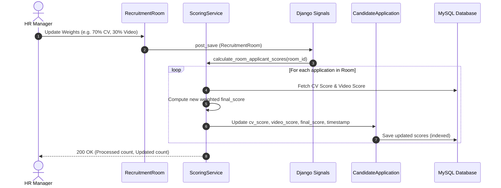

# CareerFlow — Sprint 5 Scoring Architecture Specification
## US-23: Final Applicant Score Calculation Combining CV and Video Scores
**Author / System Architect:** Nafisa Tabassum Maria (Sy De / S Arch)  
**Epic:** Epic 6: Scoring & Shortlisting  
**Target Story:** US-23 (`feat/us-23-final-score-calculation`)  
**Status:** Approved & Implemented  

---

## 1. Executive Summary & Purpose
In CareerFlow, talent evaluation combines multi-modal AI inputs:
1. **CV Semantic Job Matching (US-06 to US-10):** Semantic embedding comparison between parsed candidate skills/experience and HR-defined job requirements.
2. **Video Presentation Analysis (US-11 to US-15):** Multi-modal speech analysis (Whisper speech pacing, clarity, filler word control) and computer vision behavioral metrics (head pose, eye contact, shoulder stability).

The purpose of **US-23** is to provide an objective, mathematically deterministic, and explainable **Final Applicant Score** ($Score_{final} \in [0.0, 100.0]$) that aggregates these multi-modal evaluations according to HR-configured room weights (`cv_weight` and `video_weight`).

---

## 2. Mathematical Scoring Model

### 2.1 Variables & Input Contracts
Let an application $A$ belong to a Recruitment Room $R$ and Candidate $C$:

| Parameter | Symbol | Data Type | Range | Description |
| :--- | :--- | :--- | :--- | :--- |
| **CV Match Score** | $S_{cv}$ | `float` | $[0.0, 100.0]$ | Overall semantic similarity and skill coverage score from `CVJobMatch.match_score`. |
| **Video Score** | $S_{video}$ | `float` | $[0.0, 100.0]$ | Composite presentation score from `PresentationScore.overall_score`. |
| **CV Weight** | $W_{cv}$ | `int` | $[0, 100]$ | Percentage weight assigned by HR to CV evaluation in `RecruitmentRoom.cv_weight`. |
| **Video Weight** | $W_{video}$ | `int` | $[0, 100]$ | Percentage weight assigned by HR to Video evaluation in `RecruitmentRoom.video_weight`. |
| **Final Score** | $Score_{final}$ | `float` | $[0.0, 100.0]$ | Aggregated composite applicant score, stored in `CandidateApplication.final_score`. |
| **Partial Flag** | $is\_partial$ | `bool` | `{True, False}` | Flag indicating whether the score was computed with missing components. |

### 2.2 Core Weighted Aggregation Formula
When both CV and Video evaluations are complete ($S_{cv} \neq \emptyset$ and $S_{video} \neq \emptyset$):

$$Score_{final} = \text{round}\left( \frac{(W_{cv} \times S_{cv}) + (W_{video} \times S_{video})}{100.0}, 1 \right)$$

Where:
- $W_{cv} + W_{video} = 100$
- Output is rounded to **1 decimal place** (e.g. $87.25 \rightarrow 87.3$).

### 2.3 Weight Validation & Fallback Rules
1. **Default Weighting (AC#2):**
   If a Recruitment Room has unconfigured or null weights ($W_{cv} = \text{None}$ or $W_{video} = \text{None}$), or if the sum does not equal 100%, the engine automatically applies the default **50% CV / 50% Video** split:
   $$W_{cv} = 50, \quad W_{video} = 50$$
2. **Boundary Validation:**
   Weights must satisfy $0 \le W_{cv} \le 100$ and $0 \le W_{video} \le 100$. Database check constraints (`check_recruitment_room_weights_range`) enforce valid integer ranges.

---

## 3. Boundary Conditions & Extreme Scenarios

| Scenario | $W_{cv}$ | $W_{video}$ | $S_{cv}$ | $S_{video}$ | Calculation | $Score_{final}$ | $is\_partial$ |
| :--- | :--- | :--- | :--- | :--- | :--- | :--- | :--- |
| **Standard 50/50** | 50 | 50 | 80.0 | 90.0 | $\frac{50 \times 80 + 50 \times 90}{100} = 85.0$ | **85.0** | `False` |
| **Custom 70/30** | 70 | 30 | 85.0 | 72.0 | $\frac{70 \times 85 + 30 \times 72}{100} = 81.1$ | **81.1** | `False` |
| **100% CV Solo** | 100 | 0 | 94.0 | 60.0 | $\frac{100 \times 94 + 0 \times 60}{100} = 94.0$ | **94.0** | `False` |
| **100% Video Solo**| 0 | 100 | 95.0 | 88.0 | $\frac{0 \times 95 + 100 \times 88}{100} = 88.0$ | **88.0** | `False` |
| **Zero Score Edge** | 50 | 50 | 0.0 | 0.0 | $\frac{50 \times 0 + 50 \times 0}{100} = 0.0$ | **0.0** | `False` |
| **Perfect Score** | 60 | 40 | 100.0 | 100.0 | $\frac{60 \times 100 + 40 \times 100}{100} = 100.0$ | **100.0** | `False` |

---

## 4. Incomplete & Missing Data Handling (Graceful Degradation)

In high-volume recruitment workflows, applicants may upload only a CV, their video may still be in the processing queue, or an analysis pipeline may encounter a temporary failure. The scoring service handles these states deterministically:

```
                                  ┌──────────────────────────────┐
                                  │ Application Score Requested  │
                                  └──────────────┬───────────────┘
                                                 │
                                                 ▼
                                     ┌───────────────────────┐
                                     │ Are both CV and Video │
                                     │   Scores Available?   │
                                     └───────────┬───────────┘
                                                 │
                                 ┌───────────────┴───────────────┐
                              Yes│                               │No
                                 ▼                               ▼
                 ┌──────────────────────────────┐ ┌──────────────────────────────┐
                 │ Full Weighted Aggregation:   │ │  Check Available Components  │
                 │ Score = (W_cv*S_cv +         │ └──────────────┬───────────────┘
                 │          W_vid*S_vid)/100    │                │
                 │ is_partial = False           │         ┌──────┴──────┐
                 └──────────────────────────────┘      CV │             │Video
                                                          ▼             ▼
                                             ┌────────────────┐ ┌────────────────┐
                                             │ CV Only:       │ │ Video Only:    │
                                             │ Score = S_cv   │ │ Score = S_vid  │
                                             │ is_partial=True│ │ is_partial=True│
                                             └────────────────┘ └────────────────┘
                                                          │             │
                                                          └──────┬──────┘
                                                          Neither│
                                                                 ▼
                                                    ┌──────────────────────────┐
                                                    │ Both Missing / Pending:  │
                                                    │ Score = None             │
                                                    │ is_partial = False       │
                                                    └──────────────────────────┘
```

### 4.1 State Machine Rules
1. **Case A (Both Present):**
   Full weighted aggregate computed. `is_partial_score = False`.
2. **Case B (CV Present, Video Missing/Pending):**
   If $W_{cv} > 0$: Proportional re-scaling normalizes to the available component:
   $$Score_{final} = \text{round}(S_{cv}, 1), \quad is\_partial\_score = \text{True}$$
   If $W_{cv} = 0$: $Score_{final} = 0.0, \quad is\_partial\_score = \text{True}$.
3. **Case C (Video Present, CV Missing/Pending):**
   If $W_{video} > 0$: Proportional re-scaling normalizes to the available component:
   $$Score_{final} = \text{round}(S_{video}, 1), \quad is\_partial\_score = \text{True}$$
   If $W_{video} = 0$: $Score_{final} = 0.0, \quad is\_partial\_score = \text{True}$.
4. **Case D (Both Missing/Pending):**
   $$Score_{final} = \text{None}, \quad is\_partial\_score = \text{False}$$

---

## 5. Automated Recalculation Architecture & Event Triggers

To fulfill **AC#4** (*"Final scores are recalculated automatically when room weights or candidate analysis results change"*), the system deploys event-driven hooks:



### 5.1 Trigger Sources
1. **Room Weight Modifications:**
   - Whenever `RecruitmentRoom` weights change via `PUT/PATCH /api/recruitment/rooms/{id}/weighting/` or admin update, all associated applications are recalculated immediately.
2. **Video Pipeline Completion:**
   - Whenever `PresentationScore` is saved or updated by the presentation AI worker, any `CandidateApplication` referencing that `PresentationVideo` is recalculated.
3. **CV Semantic Matching Completion:**
   - Whenever `CVJobMatch` is created or refreshed for a candidate's CV and room, the application is recalculated.
4. **Application Submission:**
   - In `PublicApplicationSubmitView`, upon ingesting files and running pipelines, the application score is initialized.
5. **On-Demand Manual Recalculation API:**
   - `POST /api/recruitment/rooms/{id}/calculate-scores/` allows HR Managers to trigger a full batch recalculation across all candidates in the room.

---

## 6. Database Storage & Indexing Strategy (US-23-T6)

```python
class CandidateApplication(models.Model):
    # Cached component scores
    cv_score = models.FloatField(
        null=True, blank=True,
        help_text="Cached CV match score (0-100)"
    )
    video_score = models.FloatField(
        null=True, blank=True,
        help_text="Cached Video presentation score (0-100)"
    )
    # Primary sorting & ranking score
    final_score = models.FloatField(
        null=True, blank=True,
        db_index=True,
        help_text="Calculated weighted final score (0-100)"
    )
    is_partial_score = models.BooleanField(
        default=False,
        help_text="True if calculated with missing CV or video"
    )
    score_calculated_at = models.DateTimeField(
        null=True, blank=True,
        help_text="Timestamp when final score was last calculated"
    )
```

### Indexing Benefits:
- `db_index=True` on `final_score` enables $O(\log N)$ query sorting for **US-24 (Applicant Ranking)** and rapid range filtering (`final_score >= 80`) for **US-25 (Automatic Shortlisting)**.
- Storing `cv_score` and `video_score` avoids repeated heavy joins across `apps.cv` and `apps.presentation` tables during dashboard rendering.
