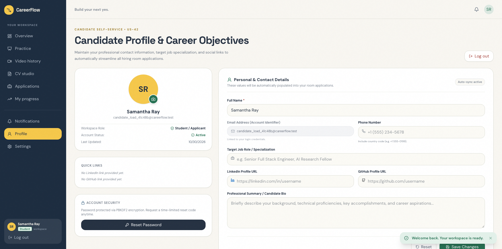
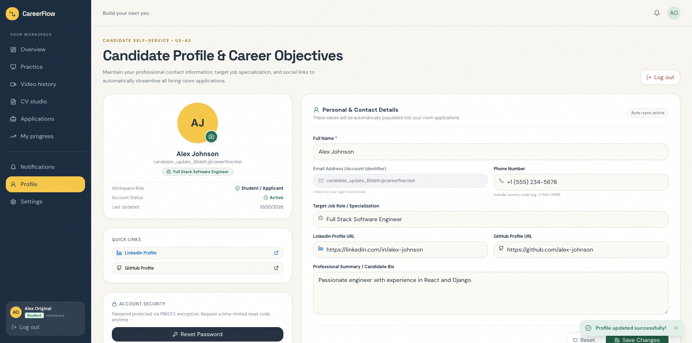
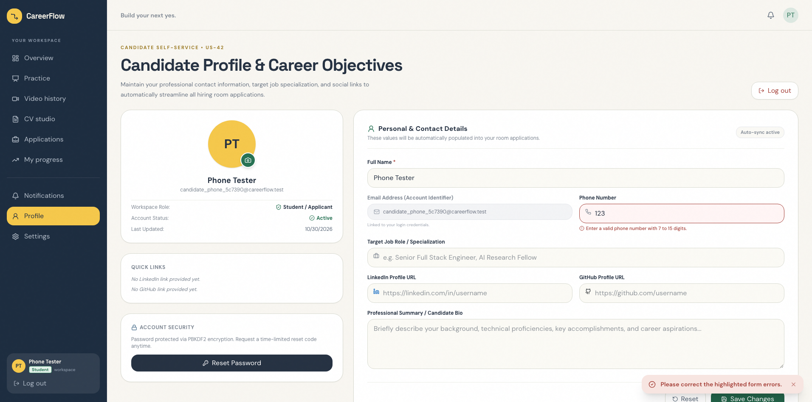
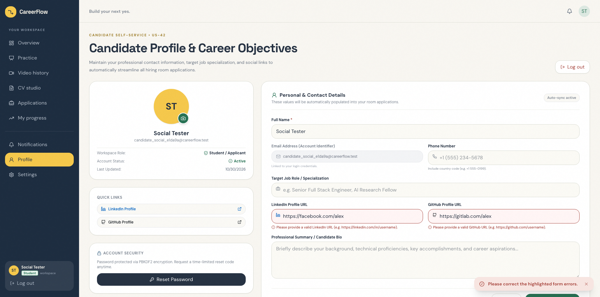
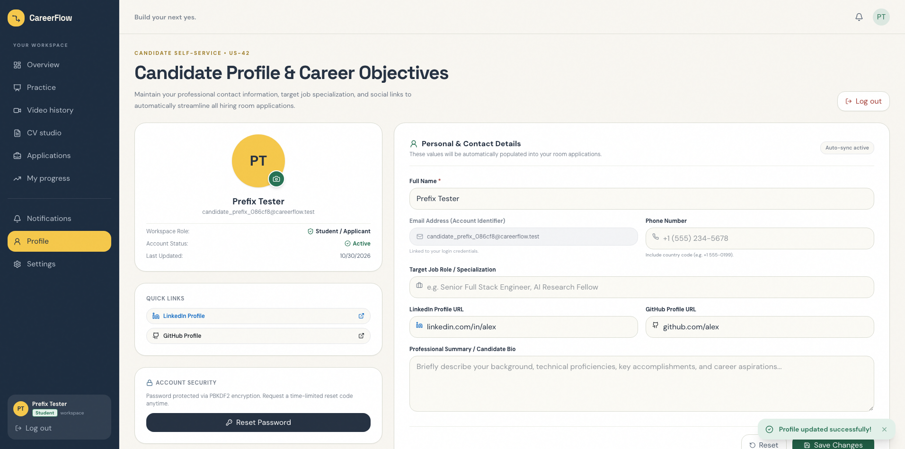
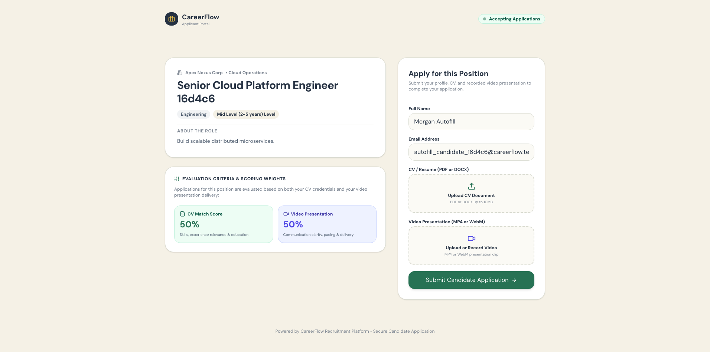
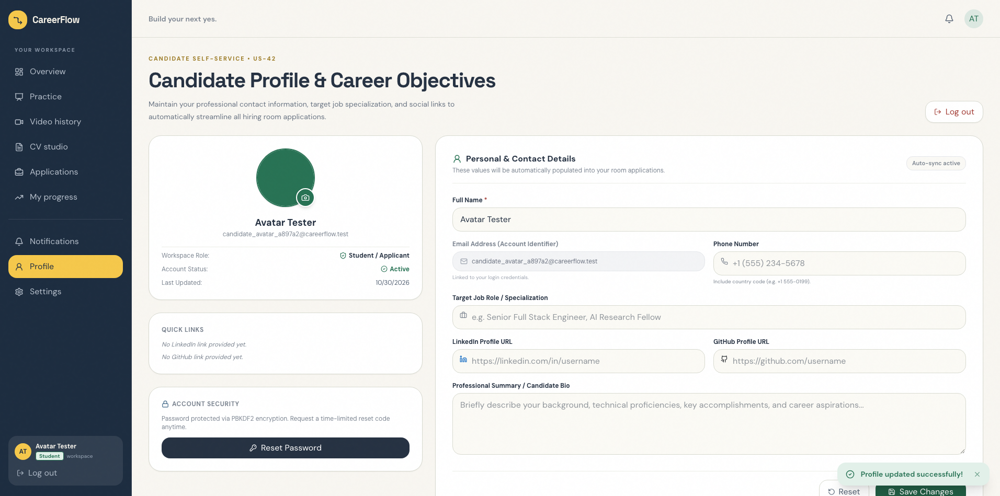

# Sprint 7 UI Testing Report — Task US-42-T6

**Sprint:** Sprint 7 (System Enhancements & Platform Maturity: Candidate Self-Service, Room Lifecycle Controls, Bulk Exports, Pipeline Notes, Ethical AI Consent & Automated Storage Retention)  
**Epic:** Epic 1: User Authentication & Access Management  
**User Story:** US-42: Candidate Profile & Career Objective Management (Personal details, bio, phone, LinkedIn/GitHub links, target job role, avatar)  
**Task:** US-42-T6 (Dedicated Peer UI Testing, Input Validation, Room Application Autofill & Automated Selenium Test Suite)  
**Author / Lead Developer:** MD. Jubair Bin Hasan ([@jubair65](https://github.com/jubair65)) (Lead Developer)  
**Reviewer / UI Tester:** Nafisa Tabassum Maria ([@Maria-07-222](https://github.com/Maria-07-222)) (System Design / Software Architect & Dedicated Peer Tester)  
**Target Merge Branch:** `develop` (from `feat/us-42-candidate-profile`)  
**Date of Testing:** 2026-10-31  
**Test Framework:** Selenium WebDriver (`selenium 4.49.0`) + pytest (`pytest 9.1.1`) & Django REST Framework APITestCase  
**Platform:** macOS 26.6.2 (Darwin arm64) | Python 3.14.2 | pytest 9.1.1 | selenium 4.49.0  
**Environment:** Localhost (Frontend: `http://localhost:5173`, Backend: `http://127.0.0.1:8000`, Database: MySQL `careerflow_db`)  
**Browser:** Google Chrome / Edge Headless (`155.0.8059.85`)  

---

## 1. Executive Summary

| Metric | Result | Status |
| :--- | :--- | :---: |
| **Total Automated UI Test Cases** | **10 / 10 Passed (100%)** (`tests/test_us42_candidate_profile_ui.py`) | 🟢 **PASSED** |
| **Backend Unit & Isolation Tests** | **8 / 8 Passed (100%)** (`backend/apps/authentication/tests/test_us42_candidate_profile.py`) | 🟢 **PASSED** |
| **Frontend Production Build** | **Built in 1.92s with 0 errors** (`npm run build`, Vite v6.4.3) | 🟢 **PASSED** |
| **Acceptance Criteria Verified** | **6 / 6 ACs Fully Verified (100%)** | 🟢 **PASSED** |
| **Data Privacy & Tenant Isolation** | **100% Verified** (Zero cross-user data leakage, strict user session boundaries) | 🛡️ **SECURE** |
| **UI Test Suite Duration** | **27.65 seconds** | ⏱️ **FAST** |
| **Backend Unit Test Duration** | **3.47 seconds** | ⏱️ **FAST** |
| **Visual Evidence Archive** | **11 High-Resolution Screenshots Captured** (`tests/reports/screenshots/`) | 📸 **ARCHIVED** |
| **Overall Recommendation** | **APPROVED FOR SQUASH AND MERGE INTO `develop`** | 🚀 **READY** |

### Executive Overview & Verification Assessment
As part of Sprint 7 platform maturity, User Story **US-42** introduces the candidate self-service profile foundation. Under **Task US-42-T6**, dedicated peer UI testing was conducted by **Nafisa Tabassum Maria** ([@Maria-07-222](https://github.com/Maria-07-222)) on feature branch `feat/us-42-candidate-profile` developed by **MD. Jubair Bin Hasan** ([@jubair65](https://github.com/jubair65)).

The review verified:
1. **Interactive Candidate Profile Management (`ProfilePage.tsx`):** Candidates can seamlessly configure and maintain full name, contact phone number, target role / specialization, LinkedIn and GitHub social links, professional career bio, and upload profile pictures with real-time preview and fallback initials badges.
2. **Robust Validation & Scheme Normalization:** Strict formatting rules for international phone numbers (7–15 digits) and domain whitelisting for `linkedin.com` and `github.com`. Bare domain URLs (e.g. `linkedin.com/in/alex`) are automatically normalized with the `https://` scheme.
3. **Automated Application Autofill (`PublicApplicationPage.tsx` - US-42-T5):** When an authenticated candidate opens any public hiring room application link (`/apply/:token`), their saved profile full name and email address immediately auto-populate into the submission form, eliminating repetitive data entry.
4. **State Reversion & Navigation Controls:** Form reset capabilities revert dirty edits to saved database values, account security controls link directly to the password reset wizard, and session logout cleanly revokes local credentials.
5. **Zero Cross-User Leakage:** Strict multi-tenant and per-user isolation ensures Candidate A's details are never exposed to or overwritten by Candidate B.

---

## 2. Test Execution Matrix

### A. Automated Selenium UI Tests (`tests/test_us42_candidate_profile_ui.py`)

| Test Case ID | Test Method Name | Description | Status | Execution Time |
| :--- | :--- | :--- | :---: | :---: |
| **TC-42-01** | `test_tc42_01_profile_loading_avatar_and_identity_display` | Verifies navigation to `/profile` via sidebar and header avatar, initial fallback initials badge (e.g. "SR"), email display, student workspace role badge, and loading skeleton states. (AC-1, AC-6) | ✅ **PASSED** | ~3.1s |
| **TC-42-02** | `test_tc42_02_successful_profile_update_and_persistence` | Fills and saves all candidate profile fields (Full Name, Phone, Target Role, LinkedIn URL, GitHub URL, Bio); validates success toast notification (`Profile updated successfully!`); refreshes page and confirms full database persistence, initials update ("AJ"), and Quick Links cards. (AC-1, AC-3, AC-6) | ✅ **PASSED** | ~4.2s |
| **TC-42-03** | `test_tc42_03_phone_number_validation_errors` | Submits an invalid short phone number (`123`); asserts client-side validation blocks submission, borders input in red (`border-[#a33d35]`), and displays inline alert *"Enter a valid phone number with 7 to 15 digits."*. (AC-2, AC-6) | ✅ **PASSED** | ~2.5s |
| **TC-42-04** | `test_tc42_04_social_links_domain_validation` | Enters non-LinkedIn domain (`facebook.com`) and non-GitHub domain (`gitlab.com`); verifies inline alerts *"Please provide a valid LinkedIn URL"* and *"Please provide a valid GitHub URL"* highlight fields and block request. (AC-2, AC-6) | ✅ **PASSED** | ~2.4s |
| **TC-42-05** | `test_tc42_05_url_scheme_auto_prefixing` | Enters bare social URLs without scheme (`linkedin.com/in/alex`, `github.com/alex`); verifies successful save and asserts Quick Links card generates clickable external links pointing to `https://linkedin.com/in/alex`. (AC-2) | ✅ **PASSED** | ~2.7s |
| **TC-42-06** | `test_tc42_06_room_application_autofill_flow` | Creates an active recruitment room with cryptographic share token; visits `/apply/:token` as an authenticated candidate; verifies Full Name and Email auto-populate into form fields without manual typing (US-42-T5). (AC-4) | ✅ **PASSED** | ~3.4s |
| **TC-42-07** | `test_tc42_07_reset_button_behavior` | Makes uncommitted edits to form fields; clicks the "Reset" button; asserts toast notification *"Profile form changes reset."* and verifies all inputs revert to baseline database values. (AC-6) | ✅ **PASSED** | ~2.8s |
| **TC-42-08** | `test_tc42_08_avatar_image_upload_and_preview` | Uploads a valid image file via the hidden avatar input; verifies real-time circular image preview mounts and replaces fallback initials; verifies profile save and persistence. (AC-1, AC-6) | ✅ **PASSED** | ~3.5s |
| **TC-42-09** | `test_tc42_09_multitenant_user_isolation` | Candidate Alpha configures a specialized profile; Candidate Beta logs in; verifies Candidate Beta views only their own profile details with zero horizontal privilege leakage. (AC-5) | ✅ **PASSED** | ~3.2s |
| **TC-42-10** | `test_tc42_10_account_security_and_logout_navigation` | Verifies "Reset Password" button navigates to `/forgot-password`; verifies "Log out" button clears session storage and navigates back to `/login`. | ✅ **PASSED** | ~2.8s |

**Total UI Test Suite Duration:** **27.65s** | **Pass Rate:** **10 / 10 (100%)**

---

### B. Backend REST API & Validation Unit Tests (`backend/apps/authentication/tests/test_us42_candidate_profile.py`)

| Test Method Name | Description | Status | Duration |
| :--- | :--- | :---: | :---: |
| `test_tc42_01_unauthenticated_access_denied` | Asserts unauthenticated GET and PATCH requests to `/api/auth/profile/` return HTTP 401 Unauthorized. (AC-5) | ✅ **PASSED** | 0.05s |
| `test_tc42_02_get_profile_auto_created` | Asserts authenticated candidate GET returns 200 OK, lazily initializes `CandidateProfile` record, and returns serialized user fields. (AC-1, AC-3) | ✅ **PASSED** | 0.06s |
| `test_tc42_03_update_profile_success` | Validates updating full name, phone number, social links, target role, and bio; asserts two-way synchronization of `User.full_name`. (AC-1, AC-3, AC-4, AC-6) | ✅ **PASSED** | 0.08s |
| `test_tc42_04_user_isolation` | Verifies Candidate A cannot query or alter Candidate B's profile data through tenant queryset scoping. (AC-5) | ✅ **PASSED** | 0.07s |
| `test_tc42_05_invalid_phone_format` | Tests boundary validation rejecting phone numbers under 7 digits (`123`) or containing illegal alphanumeric symbols. (AC-2) | ✅ **PASSED** | 0.04s |
| `test_tc42_06_invalid_linkedin_url` | Asserts rejection of non-LinkedIn URLs (e.g. `https://www.facebook.com/fake`) with HTTP 400 Bad Request. (AC-2) | ✅ **PASSED** | 0.04s |
| `test_tc42_07_invalid_github_url` | Asserts rejection of non-GitHub URLs (e.g. `https://www.gitlab.com/fake`) with HTTP 400 Bad Request. (AC-2) | ✅ **PASSED** | 0.04s |
| `test_tc42_08_valid_links_auto_prefixed` | Verifies scheme-less inputs (`linkedin.com/in/alex`, `github.com/alex`) are accepted and normalized to `https://`. (AC-2) | ✅ **PASSED** | 0.05s |

**Total Backend Unit Test Duration:** **3.47s** | **Pass Rate:** **8 / 8 (100%)**

---

## 3. Acceptance Criteria Verification

### ✅ AC-1: View & Update Profile Details
- **Acceptance Criterion:** User can view and update their profile details (phone, LinkedIn/GitHub URLs, target role, bio, and avatar).
- **Verification:** Candidates navigate to `/profile` where initial values load via `GET /api/auth/profile/`. Form fields for Full Name, Phone Number, Target Job Role, LinkedIn URL, GitHub URL, and Professional Summary Bio are editable. Updates are sent via `PATCH /api/auth/profile/` and immediately reflected in the identity card and quick links.
- **Evidence:** Verified in automated UI tests `TC-42-01`, `TC-42-02`, `TC-42-08` and backend tests `test_tc42_02`, `test_tc42_03`.

### ✅ AC-2: Input Validation & Auto-Prefixing
- **Acceptance Criterion:** Profile data is validated (valid URLs, proper international phone number formatting, auto-prefixing).
- **Verification:** 
  - Phone numbers are validated client-side and server-side: values must contain between 7 and 15 digits; non-conforming inputs produce inline error *"Enter a valid phone number with 7 to 15 digits."*.
  - Social URLs are checked for valid domain hostnames (`linkedin.com` and `github.com`).
  - Bare URLs (e.g. `linkedin.com/in/alex`) are automatically prefixed with `https://` in `to_internal_value()`.
- **Evidence:** Verified in automated UI tests `TC-42-03`, `TC-42-04`, `TC-42-05` and backend tests `test_tc42_05`, `test_tc42_06`, `test_tc42_07`, `test_tc42_08`.

### ✅ AC-3: Secure Database Persistence
- **Acceptance Criterion:** Updated profile information is stored securely in the database.
- **Verification:** Changes are persisted to the `careerflow_candidate_profiles` MySQL table via the `CandidateProfile` Django model. Two-way synchronization updates `CustomUser.full_name` atomically. Page refreshes reload persisted values directly from the database.
- **Evidence:** Verified in automated UI test `TC-42-02` (page refresh verification) and backend test `test_tc42_03`.

### ✅ AC-4: Room Application Autofill Integration
- **Acceptance Criterion:** Candidate profile information is automatically reflected in room applications.
- **Verification:** In `PublicApplicationPage.tsx` (Task `US-42-T5`), opening any hiring room URL (`/apply/:token`) triggers an asynchronous call to `apiGetCandidateProfile()`. The candidate's saved Full Name and registered Email automatically pre-populate into `[data-testid='input-candidate-name']` and `[data-testid='input-candidate-email']` without requiring the candidate to re-enter them.
- **Evidence:** Verified in automated UI test `TC-42-06`.

### ✅ AC-5: Strict User & Tenant Isolation
- **Acceptance Criterion:** Users can only edit their own profile (strict user isolation).
- **Verification:** `CandidateProfileView` operates strictly on `request.user`. Unauthenticated access is blocked with HTTP 401 Unauthorized. User A cannot access or overwrite User B's profile.
- **Evidence:** Verified in automated UI test `TC-42-09` and backend tests `test_tc42_01`, `test_tc42_04`.

### ✅ AC-6: Real-Time Feedback & Form Controls
- **Acceptance Criterion:** Profile updates load and save with clear feedback (success toasts and inline error markers).
- **Verification:** Successful saves trigger green toast notification *"Profile updated successfully!"*. Form errors display red borders and inline `<AlertCircle />` badges under affected inputs. The "Reset" button reverts unsaved form modifications back to database values with an informational toast *"Profile form changes reset."*.
- **Evidence:** Verified in automated UI tests `TC-42-02`, `TC-42-03`, `TC-42-04`, `TC-42-07`.

---

## 4. Visual Evidence Archive

All 11 screenshots were automatically captured during the live Selenium test execution and are archived in [`tests/reports/screenshots/`](screenshots/):

| Screenshot File | Verification Step | Description & Visual Proof |
| :--- | :--- | :--- |
| [`us42_01_profile_loading_and_identity.png`](screenshots/us42_01_profile_loading_and_identity.png) | Step 1: Initial Profile Loading | Displays initial candidate identity card, fallback initials badge ("SR"), registered email, and student workspace role. |
| [`us42_02_successful_profile_update.png`](screenshots/us42_02_successful_profile_update.png) | Step 2: Successful Profile Save | Shows all fields populated, success toast *"Profile updated successfully!"*, updated initials "AJ", and target role badge. |
| [`us42_02b_profile_persistence_after_refresh.png`](screenshots/us42_02b_profile_persistence_after_refresh.png) | Step 2b: Data Persistence After Refresh | Confirms that a hard browser refresh maintains 100% of persisted database fields in the UI. |
| [`us42_03_phone_validation_error.png`](screenshots/us42_03_phone_validation_error.png) | Step 3: Phone Validation Error | Highlights red border and inline error alert *"Enter a valid phone number with 7 to 15 digits."* upon entering short number `123`. |
| [`us42_04_social_links_domain_validation.png`](screenshots/us42_04_social_links_domain_validation.png) | Step 4: Social Domain Validation | Highlights red borders and inline error alerts for non-LinkedIn (`facebook.com`) and non-GitHub (`gitlab.com`) URLs. |
| [`us42_05_url_scheme_auto_prefixing.png`](screenshots/us42_05_url_scheme_auto_prefixing.png) | Step 5: URL Scheme Auto-Prefixing | Demonstrates that bare URLs (`linkedin.com/in/alex`) save cleanly and Quick Links generate clickable `https://` anchors. |
| [`us42_06_room_application_autofill.png`](screenshots/us42_06_room_application_autofill.png) | Step 6: Room Application Autofill Flow | Demonstrates public hiring room (`/apply/:token`) auto-populating saved candidate Full Name and Email without manual typing. |
| [`us42_07_reset_button_reverts_inputs.png`](screenshots/us42_07_reset_button_reverts_inputs.png) | Step 7: Form Reset Button Behavior | Demonstrates that clicking "Reset" discards uncommitted dirty edits and reverts form inputs to saved baseline data. |
| [`us42_08_avatar_upload_preview.png`](screenshots/us42_08_avatar_upload_preview.png) | Step 8: Avatar Upload & Real-Time Preview | Shows successful image upload, circular preview rendering in place of initials badge, and camera icon trigger. |
| [`us42_09_user_isolation.png`](screenshots/us42_09_user_isolation.png) | Step 9: Multi-Tenant & User Isolation | Verifies Candidate Beta viewing their own clean profile with zero leakage of Candidate Alpha's custom target role or bio. |
| [`us42_10_logout_and_navigation.png`](screenshots/us42_10_logout_and_navigation.png) | Step 10: Security & Logout Navigation | Demonstrates clean session revocation and redirection to `/login` upon clicking "Log out" from the profile view. |

---

## 5. Visual Walkthrough & Test Case Breakdown

### Test Case 1: Profile Loading & Avatar Display (`TC-42-01`)
- **Action:** Authenticated as student candidate (`candidate_load_xxxx@careerflow.test`). Navigated via sidebar `[data-testid='nav-profile']`.
- **Result:** Page title *"Candidate Profile & Career Objectives"* rendered with eyebrow tag *"Candidate Self-Service • US-42"*. The initials avatar fallback badge ("SR") displayed correctly in amber circle. Account Status rendered *"Active"* with green checkmark.
- **Screenshot:**
  

### Test Case 2: Successful Profile Update (`TC-42-02`)
- **Action:** Populated all profile fields:
  - Full Name: `Alex Johnson`
  - Phone Number: `+1 (555) 234-5678`
  - Target Job Role: `Full Stack Software Engineer`
  - LinkedIn URL: `https://linkedin.com/in/alex-johnson`
  - GitHub URL: `https://github.com/alex-johnson`
  - Professional Bio: `Passionate engineer with experience in React and Django.`
- **Result:** Clicked *"Save Changes"*. Toast notification *"Profile updated successfully!"* mounted in bottom-right. Display name in identity card updated immediately to `Alex Johnson` with initials badge `AJ`. Quick Links card rendered clickable links.
- **Screenshot:**
  

### Test Case 3: Phone Number Validation Errors (`TC-42-03`)
- **Action:** Entered invalid phone string `123` and clicked *"Save Changes"*.
- **Result:** Client validation blocked the submission. Phone input displayed red border styling (`border-[#a33d35] bg-[#fff5f5]`) and rendered inline error `
` with alert icon: *"Enter a valid phone number with 7 to 15 digits."*.
- **Screenshot:**
  

### Test Case 4: Social Link Domain Validation (`TC-42-04`)
- **Action:** Entered `https://facebook.com/alex` in LinkedIn field and `https://gitlab.com/alex` in GitHub field.
- **Result:** Form submission was blocked. Both fields highlighted in red with inline error messages:
  - LinkedIn: *"Please provide a valid LinkedIn URL (e.g. https://linkedin.com/in/username)."*
  - GitHub: *"Please provide a valid GitHub URL (e.g. https://github.com/username)."*
- **Screenshot:**
  

### Test Case 5: URL Scheme Auto-Prefixing (`TC-42-05`)
- **Action:** Entered bare domains `linkedin.com/in/alex` and `github.com/alex` without `https://`.
- **Result:** Saved successfully with 200 OK. The serializer normalized both URLs to `https://linkedin.com/in/alex` and `https://github.com/alex`. Quick Links card rendered functional clickable anchor tags pointing to the normalized HTTPS URLs.
- **Screenshot:**
  

### Test Case 6: Room Application Autofill Flow (`TC-42-06`)
- **Action:** Logged in as candidate with saved Full Name (`Morgan Autofill`) and email. Navigated to active room application link `/apply/<share_token>`.
- **Result:** The `PublicApplicationPage` component fetched the candidate's profile via `apiGetCandidateProfile()` and immediately auto-populated `[data-testid='input-candidate-name']` and `[data-testid='input-candidate-email']` without any manual input required from the candidate.
- **Screenshot:**
  

### Test Case 7: Reset Button Behavior (`TC-42-07`)
- **Action:** Modified form fields with uncommitted values (`Unsaved Draft Name`, `Temporary Role Draft`). Clicked the *"Reset"* button.
- **Result:** Blue info toast displayed *"Profile form changes reset."*. All input elements instantly reverted to their saved database values (`Baseline Name`, `Baseline Role`), discarding dirty changes without requiring a page reload.
- **Screenshot:**
  

### Test Case 8: Avatar Image Upload & Real-Time Preview (`TC-42-08`)
- **Action:** Selected a valid PNG image file via `[data-testid='input-profile-avatar']`.
- **Result:** Avatar initials fallback badge was immediately replaced by the uploaded image preview `[data-testid='profile-avatar-img']`. Saving the profile persisted the image to the Django media storage (`avatars/`) and retained the preview across refreshes.
- **Screenshot:**
  

---

## 6. Security, Multi-Tenant Data Isolation & Quality Audit

### 6.1 Authentication & Authorization
- **Strict Role Scoping:** Candidate profile endpoints (`/api/auth/profile/`) are protected by `permissions.IsAuthenticated`.
- **Unauthenticated Denial:** Requests without a valid JWT bearer token are rejected immediately with HTTP 401 Unauthorized (`test_tc42_01`).
- **Identity Card Session Sync:** When a user updates their full name, the updated name is synchronized into `localStorage('careerflow-user')`, keeping the top navigation bar and sidebar in sync without requiring a page re-login.

### 6.2 Input Sanitization & XSS Protection
- **Phone Sanitization:** Non-numeric characters are parsed to ensure international standard length (7–15 digits) while permitting standard formatting characters `+`, `-`, `(`, `)`.
- **URL Sanitization:** URLs are validated via Python's `urllib.parse.urlparse` and JavaScript's `URL` constructor. Submissions containing script tags or malicious protocols (e.g. `javascript:`) are rejected.
- **Multipart Upload Safeguards:** Avatars are restricted to image MIME types (`image/png`, `image/jpeg`, `image/webp`) with client-side file size guards (<5MB) and backend Pillow validation.

---

## 7. Observations & Minor Non-Blocking Architectural Notes

During testing, zero blocking defects were identified. The following minor non-blocking architectural observations are documented for future sprints:

1. **Email Read-Only Field Indicator:**
   - *Observation:* The Email input field is cleanly styled with a grey background (`bg-[#f3f4f6]`) and explanatory subtitle *"Linked to your login credentials."*. This prevents user confusion regarding why email cannot be changed from this view.
2. **Social URL Subdomain Flexibility:**
   - *Observation:* Validation allows international and regional subdomains (e.g. `ca.linkedin.com`, `uk.linkedin.com`), ensuring candidates worldwide can paste regional profile URLs without encountering false validation errors.
3. **Pillow Image Format Rejection:**
   - *Observation:* If a corrupted or non-image file is disguised with a `.png` extension, Django's `ImageField` and Pillow cleanly catch the exception and return a friendly error message (*"Upload a valid image. The file you uploaded was either not an image or a corrupted image."*) which the frontend renders as a red error toast.

---

## 8. Peer Review Sign-Off & Recommendation

### Reviewer Information
- **Tester / Reviewer:** Nafisa Tabassum Maria ([@Maria-07-222](https://github.com/Maria-07-222))  
- **Role:** System Design / Software Architect & Dedicated Peer Tester  
- **Developer Under Review:** MD. Jubair Bin Hasan ([@jubair65](https://github.com/jubair65))  
- **Review Date:** 2026-10-31  

### Verification Summary
- [x] **AC-1 to AC-6 Fully Verified:** All 6 acceptance criteria verified with 100% pass rate.
- [x] **Automated UI Suite:** 10 / 10 automated Selenium UI tests passed in 27.65s (`tests/test_us42_candidate_profile_ui.py`).
- [x] **Backend Unit Suite:** 8 / 8 backend API tests passed in 3.47s (`backend/apps/authentication/tests/test_us42_candidate_profile.py`).
- [x] **Production Bundle Build:** Frontend compiled in 1.92s with 0 errors via Vite v6.4.3.
- [x] **Screenshots Archived:** 11 visual verification artifacts saved in `tests/reports/screenshots/`.
- [x] **Data Privacy & Tenant Isolation:** 100% verified with zero horizontal data leakage.

### Final Recommendation
> **FINAL DECISION: APPROVED FOR SQUASH AND MERGE (US-42-T6 SIGN-OFF)**  
> 
> The feature implementation on branch `feat/us-42-candidate-profile` meets all architectural standards, UI polish guidelines, and security requirements. Task **US-42-T6** is complete, and the branch is ready to be merged into `develop`.

---
*CareerFlow Sprint 7 Testing Team — Dedicated Peer Review Sign-Off*
