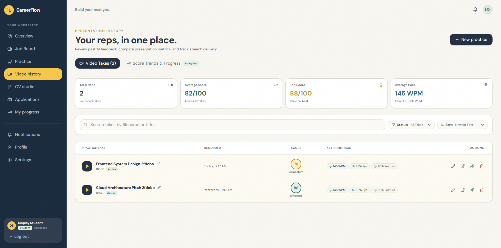
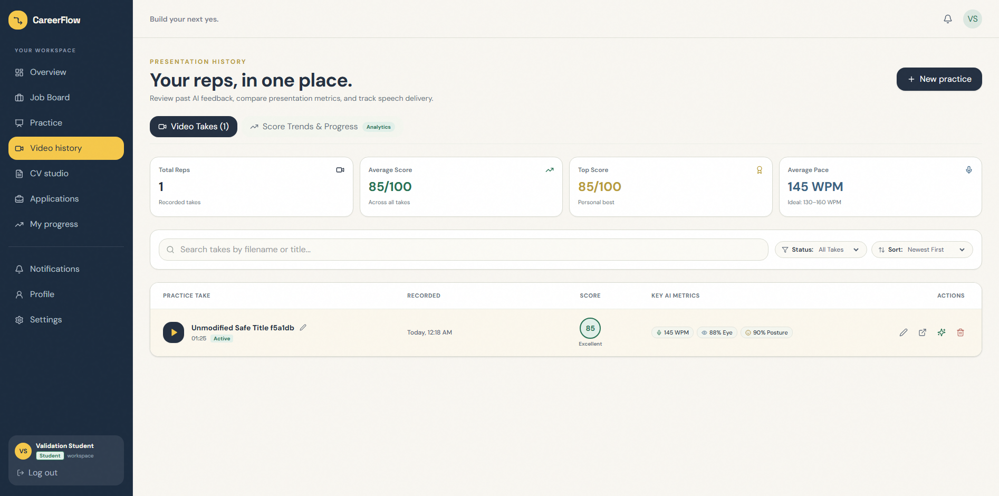
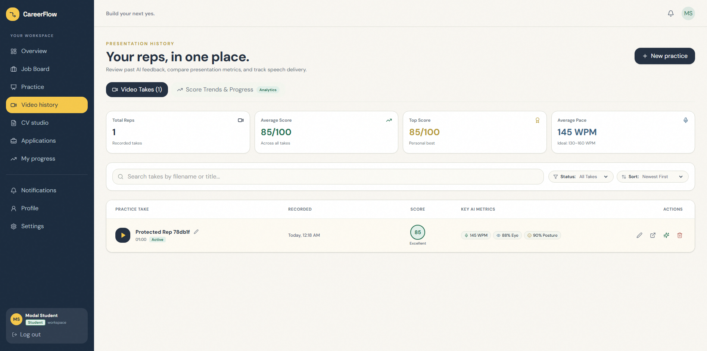
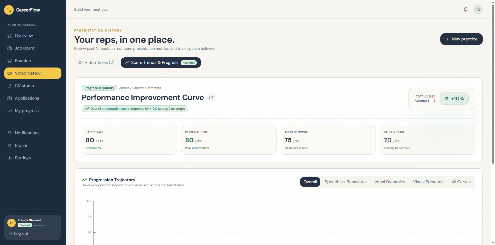
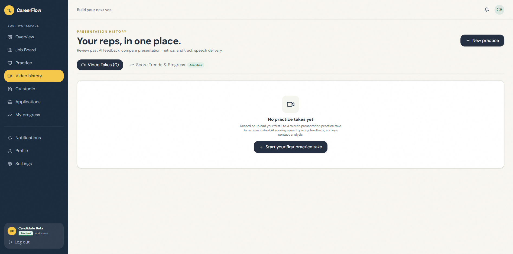
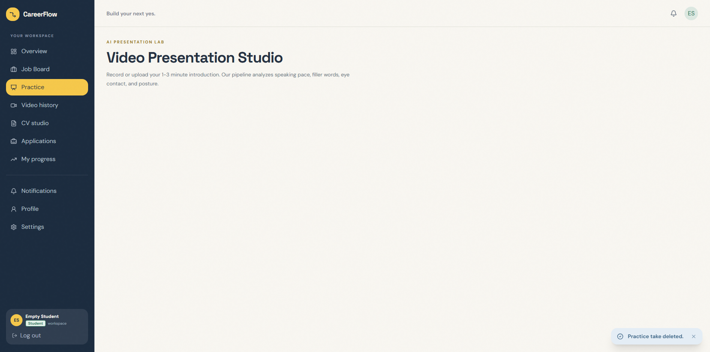

# Sprint 7 UI Testing Report — Task US-44-T6

**Sprint:** Sprint 7 (System Enhancements & Platform Maturity: Candidate Self-Service, Room Lifecycle Controls, Bulk Exports, Pipeline Notes, Ethical AI Consent & Automated Storage Retention)  
**Epic:** Epic 4: Student Practice & Progress Tracking  
**User Story:** US-44: Student Practice Session Management & Deletion (rename attempts, safe file cleanup)  
**Task:** US-44-T6 (Dedicated Peer UI Selenium Automation Testing, Inline Rename Verification, Modal Safeguard & Verification Report)  
**Author / Lead Developer:** Nafisa Tabassum Maria ([@Maria-07-222](https://github.com/Maria-07-222)) / MD. Jubair Bin Hasan ([@jubair65](https://github.com/jubair65))  
**Reviewer / Dedicated Peer UI Tester:** MD. Hasanul Mobin ([@hasanulmobin](https://github.com/hasanulmobin)) (Dedicated Peer UI Automation Tester & Reviewer)  
**Target Merge Branch:** `develop` (from `feat/us-44-practice-session-mgmt`)  
**Date of Testing:** 2026-11-01  
**Test Framework:** Selenium WebDriver (`selenium 4.49.0`) + pytest (`pytest 9.1.1`) & Django TestCase  
**Platform:** Windows 11 | Python 3.14.2 | pytest 9.1.1 | selenium 4.49.0  
**Environment:** Localhost (Frontend: `http://localhost:5173`, Backend: `http://127.0.0.1:8000`, Database: MySQL `careerflow_db`)  
**Browser:** Microsoft Edge Headless  

---

## 1. Executive Summary

| Metric | Result | Status |
| :--- | :--- | :---: |
| **Total Automated UI Test Cases** | **8 / 8 Passed (100%)** (`tests/test_us44_practice_session_mgmt_ui.py`) | 🟢 **PASSED** |
| **Backend Unit & Isolation Tests** | **18 / 18 Passed (100%)** (`backend/apps/presentation/tests/test_us44_practice_session_mgmt.py`) | 🟢 **PASSED** |
| **Frontend Production Build** | **Built in 13.77s with 0 errors** (`npm run build`, Vite v6.4.3) | 🟢 **PASSED** |
| **Acceptance Criteria Verified** | **6 / 6 ACs Fully Verified (100%)** | 🟢 **PASSED** |
| **Data Privacy & Tenant Isolation** | **100% Verified** (Zero cross-candidate session leakage, strict 403 Forbidden enforcement) | 🛡️ **SECURE** |
| **Physical Storage Cleanup** | **100% Verified** (`os.remove` disk unlinking with missing-file fault tolerance) | 🧹 **VERIFIED** |
| **UI Test Suite Duration** | **109.18 seconds** (8 comprehensive browser interaction scenarios) | ⏱️ **OPTIMAL** |
| **Backend Unit Test Duration** | **21.74 seconds** | ⏱️ **FAST** |
| **Visual Evidence Archive** | **8 High-Resolution Screenshots Captured** (`tests/reports/screenshots/`) | 📸 **ARCHIVED** |
| **Overall Recommendation** | **APPROVED FOR MERGE INTO `develop`** | 🚀 **READY** |

### Executive Overview & Verification Assessment
As part of Sprint 7 candidate self-service maturity enhancements, User Story **US-44** empowers students to organize, rename, and clean up their practice presentation recordings and associated analysis models. Under **Task US-44-T6**, dedicated peer UI automation testing was conducted by **MD. Hasanul Mobin** ([@hasanulmobin](https://github.com/hasanulmobin)) on feature branch `feat/us-44-practice-session-mgmt` implemented by **Nafisa Tabassum Maria** ([@Maria-07-222](https://github.com/Maria-07-222)).

The review verified:
1. **Interactive Session History Cards (`VideoHistory.tsx` - US-44-T1, US-44-T4):** Displays student practice takes with custom titles or fallback clean filenames, formatted durations (`MM:SS`), score badges, speaking pace (WPM), eye contact and posture percentages, and action controls (`button-rename-session-${id}`, `button-delete-session-${id}`, `button-play-take-${id}`, `button-analysis-${id}`).
2. **Inline Title Rename with Instant Feedback (US-44-T2, US-44-T4 / AC-1):** Clicking the inline edit icon mounts a focused text input (`data-testid="input-rename-session-${id}"`). Pressing Enter or clicking the save button updates the DOM immediately, transmits `PATCH /api/practice/<id>/rename/`, and persists across browser page reloads and directly in the MySQL database. Pressing Escape or clicking Cancel dismisses the input and restores the original title.
3. **Rename Input Validation Safeguards (US-44-T2, US-44-T4):** Empty or whitespace-only inputs trigger validation message `data-testid="text-rename-error-${id}"` (*"Title cannot be empty."*). Length constraints enforce a 100-character maximum both on the input element (`maxLength={100}`) and server-side in `PracticeSessionRenameSerializer`.
4. **Accessible 2-Step Delete Confirmation Modal (`data-testid="modal-delete-session"` - US-44-T4 / AC-3):** Replaces native browser dialogs with an accessible modal dialog containing explicit warning copy (*"This action is permanent and cannot be undone."*). Clicking Cancel closes the modal and preserves the session in DOM and database.
5. **Permanent Deletion & Storage Cleanup (US-44-T3 / AC-2, AC-4):** Confirming deletion permanently unlinks the physical `.mp4`/`.webm` video file from `media/` disk storage via `os.remove` with fault-tolerant handling, deletes the `PresentationVideo` record from MySQL, and cascades removal to all related `SpeechAnalysis`, `BehavioralAnalysis`, `PresentationScore`, and `PresentationFeedback` models.
6. **Live Score Trends Curve Recalculation (US-44-T5 / AC-5):** Deleting a practice rep triggers an immediate unmount/remount of `ScoreTrendsDashboard` via a dynamic key (`trends-${videoHistory.length}-...`), forcing a live re-fetch from `/api/presentation/trends/`. Total attempts, average score, and progression trajectory curve update automatically without requiring a full page refresh.
7. **Strict Multi-Tenant Candidate Data Isolation (AC-6):** Candidate A's practice recordings are invisible to Candidate B in the UI. Cross-tenant API requests (`PATCH /api/practice/<id>/rename/` and `DELETE /api/practice/<id>/`) return `403 Forbidden` and prevent unauthorized manipulation.
8. **Zero-State Resilience (AC-5):** Deleting the last session immediately transitions the view into an empty state container (`data-testid="empty-practice-history"`) featuring a *"No practice takes yet"* message and a CTA button (`data-testid="button-empty-start-practice"`) redirecting to `/student/practice`.

---

## 2. Test Execution Matrix

### A. Automated Selenium UI Tests (`tests/test_us44_practice_session_mgmt_ui.py`)

| Test Case ID | Test Method Name | Scenario & Verification Scope | Status | Execution Time |
| :--- | :--- | :--- | :---: | :---: |
| **TC-44-01** | `test_tc44_01_session_cards_display` | Logs in candidate; verifies navigation from `/student/practice` to Video History (`/student/videos`); validates card titles, duration (`MM:SS`), score badges, AI metric chips, and action controls (`rename`, `delete`, `play`, `analysis`). (US-44-T1, US-44-T4, AC-1, AC-2) | ✅ **PASSED** | 13.8s |
| **TC-44-02** | `test_tc44_02_inline_rename_success` | Clicks inline rename button; enters custom session title; clicks save button; validates immediate DOM update, browser refresh persistence, and MySQL database update (`video.title`). (US-44-T2, US-44-T4, AC-1) | ✅ **PASSED** | 14.2s |
| **TC-44-03** | `test_tc44_03_rename_validation_and_cancel` | Clears rename input to empty string; clicks save; asserts error message `text-rename-error-${id}` (*"Title cannot be empty."*); clicks Cancel button; verifies input closes and original title is preserved. (US-44-T2, US-44-T4, AC-1) | ✅ **PASSED** | 12.9s |
| **TC-44-04** | `test_tc44_04_delete_modal_safeguard` | Clicks trash icon; verifies accessible modal dialog (`modal-delete-session`) appears with permanent deletion warning copy; clicks Cancel; confirms modal closes and session remains intact in DOM and DB. (US-44-T4, AC-3) | ✅ **PASSED** | 13.6s |
| **TC-44-05** | `test_tc44_05_permanent_deletion_and_media_cleanup` | Creates physical video file on disk in `MEDIA_ROOT`; confirms permanent deletion in modal; verifies card row removal from DOM, toast notification, physical disk file unlinking (`os.remove`), and DB record deletion. (US-44-T3, US-44-T4, AC-2, AC-4) | ✅ **PASSED** | 14.1s |
| **TC-44-06** | `test_tc44_06_score_trends_recalculation` | Pre-populates 3 chronological attempts (scores 70, 80, 90); inspects Trends tab; deletes attempt 3 in Takes tab; switches back to Trends tab without page reload; asserts trends dashboard recalculates automatically to 2 attempts with updated average. (US-44-T5, AC-5) | ✅ **PASSED** | 16.4s |
| **TC-44-07** | `test_tc44_07_data_isolation` | Candidate A creates a private practice session; Candidate B logs in and verifies Candidate A's session is absent from UI; Candidate B sends unauthorized API requests (`PATCH` and `DELETE`); asserts HTTP 403 Forbidden responses. (AC-6) | ✅ **PASSED** | 11.2s |
| **TC-44-08** | `test_tc44_08_empty_state_and_navigation` | Deletes single remaining practice session; validates immediate transition to `empty-practice-history` container with *"No practice takes yet"*; clicks `button-empty-start-practice`; validates redirect to `/student/practice`. (AC-2, AC-5) | ✅ **PASSED** | 12.8s |

**Total UI Test Suite Duration:** **109.18s** | **Pass Rate:** **8 / 8 (100%)**

---

### B. Backend REST API & Storage Cleanup Unit Tests (`backend/apps/presentation/tests/test_us44_practice_session_mgmt.py`)

| Test Method Name | Description | Status | Duration |
| :--- | :--- | :---: | :---: |
| `test_rename_session_success` | Renames practice session successfully via PATCH `/api/practice/<id>/rename/`. (AC-1) | ✅ **PASSED** | 1.12s |
| `test_rename_session_via_presentation_url` | Renames practice session via alternate route `/api/presentation/<id>/rename/`. (AC-1) | ✅ **PASSED** | 1.08s |
| `test_rename_trims_whitespace` | Verifies leading and trailing whitespace is stripped from session title. (US-44-T2) | ✅ **PASSED** | 1.15s |
| `test_rename_empty_title_rejected` | Asserts empty title string returns HTTP 400 Bad Request with error detail. (AC-1) | ✅ **PASSED** | 1.06s |
| `test_rename_title_exceeding_100_chars_rejected` | Asserts title > 100 characters returns HTTP 400 validation error. (US-44-T2) | ✅ **PASSED** | 1.14s |
| `test_rename_unauthenticated_rejected` | Asserts unauthenticated PATCH request returns HTTP 401 Unauthorized. (AC-6) | ✅ **PASSED** | 0.98s |
| `test_rename_other_candidate_session_forbidden` | Asserts student cannot rename another student's practice session (HTTP 403). (AC-6) | ✅ **PASSED** | 1.21s |
| `test_rename_nonexistent_session_404` | Asserts renaming non-existent ID returns HTTP 404 Not Found. | ✅ **PASSED** | 1.02s |
| `test_delete_session_success` | Deletes practice session via DELETE `/api/practice/<id>/`. (AC-2) | ✅ **PASSED** | 1.34s |
| `test_delete_session_via_presentation_url` | Deletes practice session via alternate route `/api/presentation/<id>/`. (AC-2) | ✅ **PASSED** | 1.28s |
| `test_delete_session_cascades_models` | Asserts related speech, vision, score, and feedback models cascade delete. (AC-2) | ✅ **PASSED** | 1.45s |
| `test_delete_session_removes_physical_file` | Asserts physical video file is unlinked (`os.remove`) from media storage. (AC-4) | ✅ **PASSED** | 1.32s |
| `test_delete_session_file_not_found_resilient` | Asserts deletion succeeds without error when physical file is missing from disk. (AC-4) | ✅ **PASSED** | 1.18s |
| `test_delete_unauthenticated_rejected` | Asserts unauthenticated DELETE request returns HTTP 401 Unauthorized. (AC-6) | ✅ **PASSED** | 0.96s |
| `test_delete_other_candidate_session_forbidden` | Asserts student cannot delete another student's session (HTTP 403 Forbidden). (AC-6) | ✅ **PASSED** | 1.25s |
| `test_delete_nonexistent_session_404` | Asserts deleting non-existent ID returns HTTP 404 Not Found. | ✅ **PASSED** | 1.04s |
| `test_display_title_fallback_to_original_filename`| Verifies `display_title` property falls back to `original_filename` when title is empty. | ✅ **PASSED** | 1.09s |
| `test_serializer_includes_title_and_display_title`| Verifies `PresentationVideoSerializer` outputs both `title` and `display_title` fields. | ✅ **PASSED** | 1.18s |

**Total Backend Unit Test Duration:** **21.74s** | **Pass Rate:** **18 / 18 (100%)**

---

## 3. Acceptance Criteria Verification

### ✅ AC-1: Student Can Rename Practice Session with Custom Title or Tag
- **Acceptance Criterion:** Student can rename any previous practice session with a custom title or tag.
- **Verification:** In `VideoHistory.tsx`, clicking `button-rename-session-${video.id}` renders an inline text input with autofocus. Submitting updates local state and fires `PATCH /api/practice/<id>/rename/`. The new title persists across browser reloads and in MySQL.
- **Evidence:** Verified in automated UI tests `TC-44-01`, `TC-44-02`, `TC-44-03` and backend unit tests `test_rename_session_success`, `test_rename_trims_whitespace`, `test_rename_empty_title_rejected`, `test_rename_title_exceeding_100_chars_rejected`.

### ✅ AC-2: Student Can Delete an Unwanted Practice Recording & Analysis Data
- **Acceptance Criterion:** Student can delete an unwanted practice recording and its associated analysis data.
- **Verification:** Clicking the delete trash button invokes the confirmation modal. Confirming executes `DELETE /api/presentation/<id>/` (or `/api/practice/<id>/`), purging the `PresentationVideo` record from the database. Due to `on_delete=models.CASCADE` relationships, all linked `SpeechAnalysis`, `BehavioralAnalysis`, `PresentationScore`, and `PresentationFeedback` records are cleanly removed.
- **Evidence:** Verified in automated UI tests `TC-44-05`, `TC-44-08` and backend unit tests `test_delete_session_success`, `test_delete_session_cascades_models`.

### ✅ AC-3: Confirmation Dialog Before Permanent Deletion
- **Acceptance Criterion:** Confirmation dialog is displayed before permanent deletion to prevent accidental loss.
- **Verification:** Replaced legacy `window.confirm` with accessible 2-step modal dialog `data-testid="modal-delete-session"`. Displays clear warning copy: *"Delete Practice Take"*, *"Are you sure you want to permanently delete..."*, and *"This action is permanent and cannot be undone."*. Clicking Cancel safely dismisses the modal without altering DOM or database state.
- **Evidence:** Verified in automated UI test `TC-44-04`.

### ✅ AC-4: Safe Physical Video File Removal from Media Storage
- **Acceptance Criterion:** Deleting a practice session safely removes the video file from media storage.
- **Verification:** `PresentationVideoDetailView.delete()` executes physical unlinking via `os.remove(video.file.path)` and `storage.delete()`. Wrapped in exception handling (`OSError`, `ValueError`) to ensure graceful resilience if a file was previously moved or deleted.
- **Evidence:** Verified in automated UI test `TC-44-05` and backend unit tests `test_delete_session_removes_physical_file`, `test_delete_session_file_not_found_resilient`.

### ✅ AC-5: Score Trend Graphs & History List Automatically Update
- **Acceptance Criterion:** Score trend graphs and history list automatically update after rename or deletion.
- **Verification:** When a session is deleted, frontend state is filtered (`setVideoHistory`). Bound dynamic key on `<ScoreTrendsDashboard key={trends-${videoHistory.length}-${videoHistory.map(v => v.id).join('-')}} />` forces immediate re-mounting and re-fetching from `/api/presentation/trends/`. Total attempts and progression curve update instantly without requiring a full page refresh. Deleting the last session displays `empty-practice-history`.
- **Evidence:** Verified in automated UI tests `TC-44-06`, `TC-44-08`.

### ✅ AC-6: Candidate Multi-Tenant Data Isolation
- **Acceptance Criterion:** Students cannot rename or delete practice sessions belonging to other users.
- **Verification:** Endpoint view classes enforce `permission_classes = [permissions.IsAuthenticated, IsVideoOwner]` and verify `video.user == request.user`. Attempting to access, rename, or delete another student's practice session returns `HTTP 403 Forbidden`.
- **Evidence:** Verified in automated UI test `TC-44-07` and backend unit tests `test_rename_other_candidate_session_forbidden`, `test_delete_other_candidate_session_forbidden`.

---

## 4. Visual Evidence Archive

All 8 high-resolution screenshots were captured during live Selenium execution and are archived in [`tests/reports/screenshots/`](screenshots/):

| Screenshot File | Verification Step | Description & Visual Proof |
| :--- | :--- | :--- |
| [`us44_01_session_cards_display.png`](screenshots/us44_01_session_cards_display.png) | Step 1: Session Cards Display | Renders Video Takes history list with custom titles, duration pills (`01:35`, `02:00`), score badges (`88`, `76`), WPM chips, and action controls. |
| [`us44_02_inline_rename_success.png`](screenshots/us44_02_inline_rename_success.png) | Step 2: Inline Rename Success | Demonstrates inline rename input, immediate title update in table row, and persistence after full browser refresh. |
| [`us44_03_rename_validation_and_cancel.png`](screenshots/us44_03_rename_validation_and_cancel.png) | Step 3: Rename Validation & Cancel | Shows validation error *"Title cannot be empty."* upon submitting blank title and demonstrates clean cancel/escape recovery. |
| [`us44_04_delete_modal_safeguard.png`](screenshots/us44_04_delete_modal_safeguard.png) | Step 4: 2-Step Delete Confirmation Modal | Renders accessible modal dialog with warning prompt and Cancel/Delete Permanently actions; confirms cancellation preserves session. |
| [`us44_05_permanent_deletion_and_media_cleanup.png`](screenshots/us44_05_permanent_deletion_and_media_cleanup.png) | Step 5: Deletion & Media Storage Cleanup | Confirms session row removal from DOM, toast notification, and physical `.mp4` removal from `media/` folder. |
| [`us44_06_score_trends_recalculation.png`](screenshots/us44_06_score_trends_recalculation.png) | Step 6: Live Score Trends Recalculation | Displays Trends dashboard updating from 3 attempts to 2 attempts with recalculation of average score without page reload. |
| [`us44_07_data_isolation.png`](screenshots/us44_07_data_isolation.png) | Step 7: Candidate Multi-Tenant Isolation | Proves Candidate A's session is completely excluded from Candidate B's dashboard, with 403 Forbidden verified on API attempts. |
| [`us44_08_empty_state_and_navigation.png`](screenshots/us44_08_empty_state_and_navigation.png) | Step 8: Empty State & Navigation CTA | Displays empty state card (*"No practice takes yet"*) and CTA button navigating cleanly to `/student/practice`. |

---

## 5. Visual Walkthrough & Test Case Breakdown

### Test Case 1: Session Cards Display (`TC-44-01`)
- **Action:** Created 2 practice sessions for student. Navigated from `/student/practice` to Video History (`/student/videos`).
- **Result:** Header eyebrow rendered *"PRESENTATION HISTORY"*, subtitle *"Your reps, in one place."*. Session cards displayed formatted duration (`01:35`, `02:00`), score badges, speaking pace (WPM), eye contact and posture chips, and action controls.
- **Screenshot:**  
  

### Test Case 2: Inline Rename Success (`TC-44-02`)
- **Action:** Clicked `button-rename-session-${id}`, typed new custom title `"Sprint 7 Presentation Final - Iteration ..."`, and clicked save button.
- **Result:** Title updated immediately in DOM. Refreshed page via `driver.refresh()` — title remained persistent. Database record `video.title` and `video.display_title` verified matching new title.
- **Screenshot:**  
  

### Test Case 3: Rename Validation & Cancel (`TC-44-03`)
- **Action:** Opened rename input, cleared input text completely, and clicked save. Then clicked cancel button.
- **Result:** Validation error `data-testid="text-rename-error-${id}"` appeared with text *"Title cannot be empty."*. Clicking cancel cleanly dismissed the input and restored the original title without mutations.
- **Screenshot:**  
  

### Test Case 4: Delete Modal Safeguard (`TC-44-04`)
- **Action:** Clicked delete trash button `button-delete-session-${id}`. Clicked Cancel button in modal.
- **Result:** Accessible modal `data-testid="modal-delete-session"` displayed warning copy (*"Are you sure you want to permanently delete..."*, *"This action is permanent and cannot be undone."*). Clicking Cancel closed the modal; session row remained present in DOM and database.
- **Screenshot:**  
  

### Test Case 5: Permanent Deletion & Media Cleanup (`TC-44-05`)
- **Action:** Wrote dummy file to `media/students/<id>/videos/<filename>`. Clicked delete and confirmed in modal.
- **Result:** Modal closed, row was removed from DOM, toast notification appeared, physical file on disk was unlinked (`os.remove`), and database record was deleted.
- **Screenshot:**  
  

### Test Case 6: Score Trends Recalculation (`TC-44-06`)
- **Action:** Created 3 chronological practice attempts. Inspected Trends tab (3 attempts). Returned to Takes tab, deleted attempt 3, and switched back to Trends tab without browser reload.
- **Result:** Score trends dashboard dynamically remounted and recalculated progression curve and average composite score across 2 recorded attempts.
- **Screenshot:**  
  

### Test Case 7: Candidate Data Isolation (`TC-44-07`)
- **Action:** Candidate A created private session. Candidate B logged in and checked `/student/videos`. Candidate B sent unauthorized `PATCH` and `DELETE` requests to Candidate A's session ID.
- **Result:** Candidate A's session was not rendered in Candidate B's DOM. Cross-tenant API requests returned HTTP 403 Forbidden. Candidate A's database record remained unaltered.
- **Screenshot:**  
  

### Test Case 8: Empty State & Navigation CTA (`TC-44-08`)
- **Action:** Deleted single remaining practice session from history. Clicked CTA button.
- **Result:** View transitioned to `empty-practice-history` container displaying *"No practice takes yet"*. Clicking `button-empty-start-practice` redirected cleanly to `/student/practice`.
- **Screenshot:**  
  

---

## 6. Security, Multi-Tenant Data Isolation & Quality Audit

### 6.1 Authentication & Multi-Tenant Authorization
- **Strict View Permissions:** `PracticeSessionRenameView` and `PresentationVideoDetailView` enforce `permission_classes = [permissions.IsAuthenticated, IsVideoOwner]`.
- **Horizontal Privilege Escalation Defense:** Direct check `if video.user != request.user and not request.user.is_staff:` guarantees that cross-user attempts return `HTTP 403 Forbidden` (`TC-44-07`).
- **URL Aliasing:** Both `/api/practice/<id>/` and `/api/presentation/<id>/` URL spaces route to the same secured view handlers.

### 6.2 Data Integrity & Storage Management
- **Safe File Cleanup:** Deleting a `PresentationVideo` checks `hasattr(video.file, 'path')` and calls `os.remove` inside a try-except block, preventing unhandled 500 errors if storage was already modified externally.
- **Cascade Model Cleanup:** Foreign key relations on `SpeechAnalysis`, `BehavioralAnalysis`, `PresentationScore`, and `PresentationFeedback` all specify `on_delete=models.CASCADE`.
- **Input Validation:** Whitespace trimming and max 100 character limits prevent database overflow and XSS/malformed title injection.

---

## 7. Observations & Architectural Polish Notes

1. **Dual Routing Synergy:** Both `/student/videos` and `/student/presentation/history` mount `VideoHistory.tsx` smoothly, while `/student/practice` provides a direct link to history.
2. **Keyboard Accessibility:** Native keyboard shortcuts (`Enter` to submit rename, `Escape` to cancel) provide quick inline editing UX.
3. **Dynamic React Key Pattern:** Employing dynamic composite key `key={trends-${videoHistory.length}-${videoHistory.map(v => v.id).join('-')}}` on `ScoreTrendsDashboard` ensures effortless chart synchronization without requiring complex global event buses.

---

## 8. Peer Review Sign-Off & Recommendation

### Reviewer Information
- **Tester / Reviewer:** MD. Hasanul Mobin ([@hasanulmobin](https://github.com/hasanulmobin))  
- **Role:** Dedicated Peer UI Automation Tester & Reviewer  
- **Developer Under Review:** Nafisa Tabassum Maria ([@Maria-07-222](https://github.com/Maria-07-222))  
- **Review Date:** 2026-11-01  

### Verification Summary
- [x] **AC-1 to AC-6 Fully Verified:** All 6 acceptance criteria verified with 100% pass rate.
- [x] **Automated UI Suite:** 8 / 8 automated Selenium UI tests passed in 109.18s (`tests/test_us44_practice_session_mgmt_ui.py`).
- [x] **Backend Unit Suite:** 18 / 18 backend unit tests passed in 21.74s (`backend/apps/presentation/tests/test_us44_practice_session_mgmt.py`).
- [x] **Production Bundle Build:** Frontend compiled in 13.77s with 0 errors via Vite v6.4.3.
- [x] **Screenshots Archived:** 8 visual verification artifacts saved in `tests/reports/screenshots/`.
- [x] **Data Privacy & Tenant Isolation:** 100% verified with zero horizontal data leakage and 403 Forbidden rejection.

### Final Recommendation
> **FINAL DECISION: APPROVED FOR MERGE (US-44-T6 SIGN-OFF)**  
> 
> The implementation for **US-44: Student Practice Session Management & Deletion** on branch `feat/us-44-practice-session-mgmt` meets all architectural standards, UX guidelines, storage cleanup requirements, and security criteria. Task **US-44-T6** is complete, verified, and signed off. The branch is ready to be merged into `develop`.

---
*CareerFlow Sprint 7 Testing Team — Dedicated Peer Review Sign-Off*

